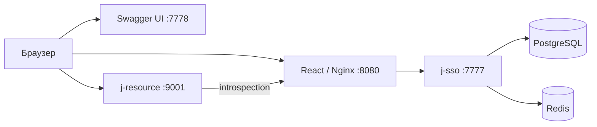

# SSO Stand

Учебный стенд единого входа на Spring Boot и Spring Security. Поддерживает вход
по логину и паролю, вход через GitHub, Google и Яндекс, а также OAuth2 Authorization
Code, Refresh Token и Client Credentials. Сервер выдаёт opaque-токены;
их состояние проверяется через introspection.

## Состав проекта

| Компонент | Назначение | Запуск |
|---|---|---|
| [j-sso](backend/j-sso) | Сервер аутентификации и OAuth2-авторизации | Compose: `j-sso-server` |
| [j-sso/client](backend/j-sso/client) | Интерфейс входа на React и Vite; Nginx раздаёт статику и проксирует запросы в SSO | Compose: `j-sso-client` |
| [j-swagger-ui](backend/j-swagger-ui) | Общий Swagger UI для спецификаций API | Compose: `j-swagger-ui` |
| PostgreSQL 18 | Пользователи, роли, OAuth2-клиенты | Compose: `sso-postgres` |
| Redis 7.4 | HTTP-сессии, OAuth2-авторизации и согласия | Compose: `sso-redis` |
| [j-resource](backend/j-resource) | Пример API с проверкой opaque-токенов через Nginx и SSO | Compose: `j-resource` |
| [webclient_app](webclient_app) | Отдельное приложение на React и TypeScript для проверки Authorization Code | Вне Compose |



Swagger UI отдаёт интерфейс браузеру; спецификации API и запросы Try it out
браузер загружает напрямую по адресам соответствующих сервисов.

## Быстрый запуск

Потребуются Docker с поддержкой BuildKit и Docker Compose v2. Java, Maven,
Node.js и npm на хосте для контейнерного запуска не нужны: образы собираются
из исходников. При первой сборке нужен доступ к реестрам образов и зависимостей.

**Все команды ниже выполняются из корня репозитория.**

### 1. Подготовить окружение

Если файла `backend/j-sso/.env` ещё нет, создать его из шаблона:

```bash
cp backend/j-sso/.env.example backend/j-sso/.env
```

Заполнить шесть переменных:

```dotenv
GITHUB_CLIENT_ID=replace-me
GITHUB_CLIENT_SECRET=replace-me
GOOGLE_CLIENT_ID=replace-me
GOOGLE_CLIENT_SECRET=replace-me
YANDEX_CLIENT_ID=replace-me
YANDEX_CLIENT_SECRET=replace-me
```

Непустых значений из шаблона достаточно для проверки запуска. Для входа через
внешних провайдеров нужны настоящие Client ID и Client Secret.
Используйте формат `KEY=value` без `export` и кавычек: этот файл также читается
Spring при локальном запуске из каталога `backend/j-sso`.

### 2. Собрать и запустить

```bash
docker compose up -d --build --wait
docker compose ps
```

Запускаются шесть сервисов: Nginx с интерфейсом входа, SSO, J resource,
Swagger UI, PostgreSQL и Redis. Liquibase применяет миграции базы при старте SSO;
Compose задаёт Spring-профиль `development`.

### 3. Открыть сервисы

| Адрес | Назначение |
|---|---|
| [localhost:8080/login](http://localhost:8080/login) | Страница входа |
| [localhost:8080/ui-test](http://localhost:8080/ui-test) | Страница, на которую направляет успешный вход в Compose |
| [localhost:7778/](http://localhost:7778/) | Swagger UI; по умолчанию выбрана спецификация SSO |
| [localhost:8080/v3/api-docs](http://localhost:8080/v3/api-docs) | OpenAPI SSO через Nginx |
| [localhost:9001/v3/api-docs](http://localhost:9001/v3/api-docs) | OpenAPI J resource; в Swagger UI выберите `J resource` |
| [localhost:7777/actuator/health](http://localhost:7777/actuator/health) | Здоровье SSO, включая PostgreSQL и Redis |
| [localhost:9001/actuator/health](http://localhost:9001/actuator/health) | Здоровье приложения J resource |
| [localhost:7778/actuator/health](http://localhost:7778/actuator/health) | Здоровье приложения Swagger UI |
| [localhost:8080/healthz](http://localhost:8080/healthz) | Здоровье Nginx |

Backend доступен напрямую на порту `7777`; GET `/login` в Compose перенаправляет
на интерфейс на порту `8080`. PostgreSQL опубликован на `localhost:5431`,
Redis — на `localhost:6379`. Настройки подключения заданы в Compose.

В dev-миграциях есть демонстрационные пользователи, но готовая проверенная пара
логин/пароль не задана. Для входа по паролю нужно установить пользователю
BCrypt-хэш известного пароля: сервер использует `BCryptPasswordEncoder`.
Запись с `{noop}` в dev-данных с этим кодировщиком несовместима.

## Как работает вход

1. Браузер открывает `/login`, и Nginx отдаёт React-приложение.
2. Форма отправляет `POST /login` через Nginx в SSO. Сервер проверяет пользователя
   из PostgreSQL; при внешнем входе выполняется OAuth2-переход к провайдеру.
3. Spring Security сохраняет контекст аутентификации в HTTP-сессии,
   Spring Session записывает её в Redis. Браузер получает cookie `SESSION`.
4. При следующих запросах SSO восстанавливает пользователя по сессии.
   При обращении приложения к `/oauth2/authorize` существующая сессия позволяет
   продолжить авторизацию без повторного ввода пароля.

HTTP-сессия и OAuth2-токены имеют отдельные жизненные циклы. По умолчанию
таймаут неактивности сессии — 1800 секунд, префикс ключей — `j-sso:session`.
OAuth2-авторизации и согласия также сохраняются в Redis отдельными сервисами.

J resource принимает Bearer-токен и проверяет его через
`http://j-sso-client/oauth2/token-info`. Запрос идёт по Docker-сети через Nginx
к SSO. Сам API работает без HTTP-сессий. Защищённые методы `/test` и `/test-auth`
доступны на порту `9001`; второй дополнительно требует права `GET_OWN_DATA`.

Основные OAuth2-адреса в Compose:

| Путь относительно `http://localhost:8080` | Назначение |
|---|---|
| `/oauth2/authorize` | Авторизация приложения, получение authorization code |
| `/oauth2/token` | Получение и обновление токенов |
| `/oauth2/token-info` | Introspection opaque-токена |
| `/oauth2/authorization/{provider}` | Начало входа через `github`, `google` или `yandex` |
| `/login/oauth2/code/{provider}` | Callback внешнего провайдера |

Для внешнего входа зарегистрируйте соответствующий callback в настройках
провайдера, например `http://localhost:8080/login/oauth2/code/yandex`.
Redirect URI OAuth2-приложения отдельно хранится в регистрации клиента в SSO.

## Настройки

Основные файлы: [Compose](docker-compose.yml),
[конфигурация SSO](backend/j-sso/src/main/resources/application.yml),
[конфигурация Swagger UI](backend/j-swagger-ui/src/main/resources/application.yml).

| Переменная | Назначение |
|---|---|
| `SSO_BACKEND_URL` | Адрес backend для Nginx; в Docker по умолчанию `http://j-sso-server:7777` |
| `SSO_API_DOCS_URL` | Спецификация SSO для Swagger UI; в Compose `http://localhost:8080/v3/api-docs` |
| `RESOURCE_API_DOCS_URL` | Спецификация примера API; по умолчанию `http://localhost:9001/v3/api-docs` |
| `RESOURCE_SSO_CLIENT_ID`, `RESOURCE_SSO_CLIENT_SECRET` | Учётные данные J resource для introspection в Compose; dev-значения `test-client` / `test-client` |
| `APP_FRONTEND_URL` | Адрес отдельного интерфейса входа; Compose задаёт `http://localhost:8080` |
| `CORS_ALLOWED_ORIGINS` | Допустимые origins браузерных приложений; SSO по умолчанию разрешает `http://localhost:7778` |
| `SPRING_SESSION_TIMEOUT` | Таймаут неактивности сессии в секундах; по умолчанию `1800` |
| `SPRING_SESSION_DATA_REDIS_NAMESPACE` | Префикс сессий Redis; по умолчанию `j-sso:session` |

`SSO_BACKEND_URL`, `SSO_API_DOCS_URL`, `RESOURCE_API_DOCS_URL`
и `RESOURCE_SSO_CLIENT_*` переопределяются
в окружении команды Compose или в корневом `.env`. Файл `backend/j-sso/.env`
передаётся только контейнеру SSO; значения из секции `environment` Compose
имеют приоритет над ним.

Адрес backend для Nginx должен быть доступен внутри Docker-сети. Адреса
спецификаций Swagger должны быть доступны из браузера: Docker-имена контейнеров
для них не подходят. После изменения переменных Compose пересоздайте нужный
сервис командой `docker compose up -d <имя-сервиса>`.

## Разработка

Для локальной разработки `j-sso` и `j-resource` нужен JDK 25, для `j-swagger-ui` — JDK 21
или новее. Maven Wrapper находится в каталогах модулей.
Общий [backend/pom.xml](backend/pom.xml) включает `j-sso`, `j-resource` и `j-swagger-ui`.

Подробные команды локальной сборки и запуска:

- [SSO: встроенный React-интерфейс, IDE, Maven-профили и настройки](backend/j-sso/README.md).
- [Swagger UI: Docker, локальный JAR и адреса спецификаций](backend/j-swagger-ui/README.md).
- [J resource: introspection через Nginx, проверка API и локальный запуск](backend/j-resource/README.md).

Только базы данных можно запустить отдельно:

```bash
docker compose up -d --wait sso-postgres sso-redis
```

`webclient_app` — отдельный OAuth2-клиент. Он настраивается через
`VITE_OAUTH_URL`, `VITE_OAUTH_CLIENT_ID`, `VITE_OAUTH_AUTH_HEADER`
и `VITE_OAUTH_REDIRECT_URI`; адрес возврата должен совпадать с регистрацией
клиента в SSO. Vite настроен на порт `8080`, занятый Nginx в Compose:
для одновременного запуска нужно выбрать другой порт и согласовать Redirect URI
и CORS с SSO.

## Проверка и управление

```bash
docker compose config --quiet
docker compose ps
curl -fsS http://localhost:7777/actuator/health
curl -fsS http://localhost:7778/actuator/health
curl -fsS http://localhost:9001/actuator/health
curl -fsS http://localhost:8080/v3/api-docs
curl -fsS http://localhost:7778/v3/api-docs/swagger-config
```

Логи, пересборка одного сервиса и остановка стенда:

```bash
docker compose logs --tail=100 j-sso-client j-sso-server j-resource j-swagger-ui
docker compose up -d --build --wait j-swagger-ui
docker compose down
```

PostgreSQL сохраняет данные в томе `postgres-data`; обычный `docker compose down`
его оставляет. `docker compose down -v` удаляет том вместе с данными БД.
Для Redis постоянный том не настроен: при пересоздании контейнера сессии,
авторизации и согласия могут потеряться.
